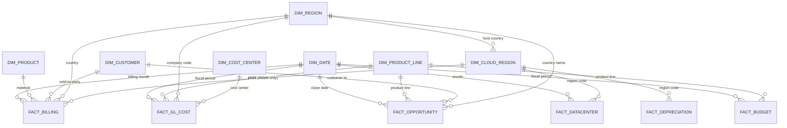

# Data Model — Where to Invest: Microsoft Growth Investment Analysis

> **ALL DATA IS SYNTHETIC, CALIBRATED TO MICROSOFT'S PUBLISHED RESULTS.** Every number is generated by
> `generate.py`. Customers, transactions, prices, cost centres, datacenter projects, pipeline deals and FX rates
> are invented, and no individual record is Microsoft data. Only the totals are calibrated: revenue by segment
> and fiscal quarter, operating margins, operating-expense ratios and capital expenditures (including finance
> leases) are close to Microsoft's published results for FY24 Q3 – FY27 Q1. Product-line splits, regional and
> datacenter figures, FY26 Q3 – FY27 Q1 capex and the FY27 Q1 split into the three FY26 segments are estimates
> (section 7).

## 1. Scope

| Item | Value |
|---|---|
| Period | 1 Jan 2024 – 30 Sep 2026 (33 months; FY24 P07 to FY27 P03) |
| Fiscal year | 1 July – 30 June. FY26 = Jul 2025 – Jun 2026. Q1 = Jul–Sep, P01 = July |
| Files | 8 CSVs in `raw/`, one per source-system export |
| Rows | ≈ 470,000 |
| Reporting currency | USD (sources are in 8 currencies: USD, EUR, GBP, JPY, CAD, AUD, INR, CHF) |
| Segments | The three FY26 segments, recast basis (Windows Commercial in Productivity and Business Processes) |
| Reproducible | `python generate.py` (seed 42) rebuilds identical files |

## 2. Source files

| # | File | Mimics an export from | One row per | Rows | Separator / formats |
|---|---|---|---|---|---|
| 1 | `product_hierarchy.csv` | ERP material master | material × validity period | 42 | `,` · dates `YYYYMMDD` |
| 2 | `regions.csv` | ERP organisation master | country | 39 | `,` |
| 3 | `treasury_fx_rates.csv` | Treasury (SAP TCURR style) | rate type × currency × month | 462 | `,` · dates `YYYYMMDD` |
| 4 | `erp_billing_lines.csv` | ERP billing (SAP style) | billing document item | 306,684 | **`;`** · dates `DD.MM.YYYY` · **decimal comma** `1.234,56` |
| 5 | `gl_cost_postings.csv` | General ledger line items (SAP FAGLL03 style) | GL line item | 120,121 | `,` · dates `DD.MM.YYYY` · **trailing minus** `1,234.56-` |
| 6 | `datacenter_regions.csv` | Datacenter operations and project-system report | cloud region × month | 1,122 | `,` · month `YYYY-MM` · percentages 0–100 |
| 7 | `crm_opportunities.csv` | CRM opportunities (Dynamics 365 Sales style) | opportunity | 41,612 | `,` · dates `MM/DD/YYYY` · `1,234.56` text numbers |
| 8 | `fpa_budget.csv` | Planning tool | version × FY × product line × line item | 300 | `,` · **2 metadata lines on top** · **wide** (months as columns) · USD thousands |

There is no calendar export: the fiscal calendar is built in SQL (`dim_date`).

## 3. Target model (star schema in DuckDB)

The raw exports are cleaned in Python (`notebooks/02_cleaning.ipynb` → `data/clean/`) and loaded into a
star schema in DuckDB (`sql/01_build_star_schema.sql`). Facts are at their natural grain and share the date dimension.

| Model table | Built from (data/clean) | Grain | Key |
|---|---|---|---|
| `dim_date` | generated in SQL (`generate_series`) | day | `calendar_date` |
| `dim_product` | products | material × validity | `material` + `valid_from`/`valid_to` |
| `dim_product_line` | products | product line | `product_line` (also `profit_center`) |
| `dim_region` | regions | country → sales area → sales region | `country_key` (also `company_code`, `country_name`) |
| `dim_cloud_region` | datacenter_regions | cloud region | `region_code` |
| `dim_customer` | billing sold-to parties + opportunities | customer | `customer_id` (= ERP Sold-To Party) |
| `dim_cost_center` | distinct cost centres in gl_costs | cost centre | `cost_center_id` |
| `fact_billing` | billing | billing item | `billing_document` + `item` |
| `fact_gl_cost` | gl_costs | GL line item | `company_code` + `document_number` |
| `fact_depreciation` | derived from fact_gl_cost (account 500300) | cloud region × month | `region_code` + `month_start` |
| `fact_datacenter` | datacenter_regions | cloud region × month | `region_code` + `month_start` |
| `fact_budget` | budget (unpivoted in Python) | version × product line × line item × month | all four |
| `fact_opportunity` | opportunities | opportunity | `opportunity_id` |

## 4. Join keys between raw files

| From | Column(s) | To | Column(s) | Notes |
|---|---|---|---|---|
| erp_billing_lines | `Material` + `Billing Date` | product_hierarchy | `Material` + `Valid From`/`Valid To` | Windows Commercial has two validity rows (segment move) |
| erp_billing_lines | `Country` | regions | `Country Key` | ISO code |
| erp_billing_lines | `Plant` | datacenter_regions | `Region Code` | filled for Azure lines only |
| erp_billing_lines | `Document Currency` + month of `Billing Date` | treasury_fx_rates | `To Currency` + `Valid From` (type `M`) | rates are foreign currency per 1 USD → USD = local ÷ rate; USD has no row |
| erp_billing_lines | `Reference Document` | erp_billing_lines | `Billing Document` | credit memo (G2) → original invoice (F2) |
| crm_opportunities | `Customer ID` | erp_billing_lines | `Sold-To Party` | about 80% of opportunities are with billed customers; the rest are prospects that never bought |
| crm_opportunities | `Country/Region` | regions | `Country Name` | full country name, not ISO code |
| crm_opportunities | `Product Line` | product_hierarchy | `Product Line` | |
| gl_cost_postings | `Profit Center` | product_hierarchy | `Profit Center` | `PC-CORP` = corporate G&A, no product line |
| gl_cost_postings | `Cost Center Name` | datacenter_regions | `Region Code` | datacenter cost centres end with their region code (`AZR-DCO-US-EUS`) |
| gl_cost_postings | `Company Code` | regions | `Company Code` | |
| gl_cost_postings | `Fiscal Year` + `Posting Period` | (calendar built in SQL) | fiscal year + fiscal period | `Fiscal Year` is numeric (2026 = FY26); P01 = July |
| fpa_budget | `Product Line` | product_hierarchy | `Product Line` | drop the `Total …` subtotal rows first |

## 5. Columns by file

**product_hierarchy** — `Material`, `Material Description`, `Product Line`, `Profit Center`, `Segment`,
`Revenue Type` (Subscription, Consumption, License, Services, Hardware, Content and Hardware, Advertising),
`Base Unit` (SEA seat, CU consumption unit, EA each, HR hour), `Valid From`, `Valid To`.

**regions** — `Country Key`, `Country Name`, `Sales Area`, `Sales Region` (Americas, EMEA, APAC),
`Billing Currency`, `Company Code`, `Primary Cloud Region`.

**treasury_fx_rates** — `Exchange Rate Type` (M monthly average, EOM month-end), `From Currency` (USD),
`To Currency`, `Valid From`, `Exchange Rate` (units of foreign currency per 1 USD).

**erp_billing_lines** — `Billing Type` (F2 invoice, G2 credit memo), `Billing Document`, `Item`,
`Billing Date`, `Sold-To Party`, `Sold-To Name`, `Country`, `Material`, `Plant` (cloud region code, Azure only),
`Billed Quantity`, `Sales Unit`, `Net Value` (local currency, decimal comma), `Document Currency`,
`Reference Document`.

**gl_cost_postings** — `Company Code`, `Fiscal Year`, `Posting Period`, `Document Number`, `Document Type`
(KR vendor invoice, PR payroll, SA GL journal / accrual, AA depreciation), `Posting Date`, `G/L Account`,
`G/L Account Text`, `Cost Center`, `Cost Center Name` (`<line>-<function>-<country>[-<cloud region>]`, e.g.
`AZR-DCO-US-EUS`), `Profit Center`, `Functional Area` (COGS, R&D, S&M, G&A), `Amount in LC`
(trailing minus = credit), `Local Currency`, `Text`, `Reversed With`.

GL accounts: 500100 Cost of Revenue – Product · 500150 Datacenter Power and Operations · 500200 Cost of
Revenue – Services · 500300 Depreciation – Datacenter Assets · 600100 Salaries and Wages · 600200
Stock-Based Compensation · 600300 Contractors · 610100 Advertising and Marketing · 610200 Partner Incentives ·
620100 Travel and Entertainment · 630100 Facilities and Rent · 640100 Software and Cloud Services ·
650100 Professional Fees.

**datacenter_regions** — `Datacenter Region`, `Region Code`, `Country`, `Month` (`YYYY-MM`),
`Capex Datacenter Build (USD)`, `Capex Server and GPU Fleet (USD)`, `Capex Network (USD)`,
`of which Finance Leases (USD)` (part of the datacenter-build capex financed by leases, about 34% of all capex),
`Installed Capacity (MW)`, `Used Capacity (MW)`, `Utilization %` (0–100), `New Capacity Online (MW)`,
`Availability %` (0–100). Useful lives for depreciation and NPV: datacenter build 15 years, server and GPU
fleet 6 years, network 10 years (set in `config.py`).

**crm_opportunities** — `Opportunity ID`, `Topic`, `Potential Customer`, `Customer ID` (= ERP Sold-To Party),
`Customer Type` (Enterprise, SMB, Public Sector, Advertiser), `Country/Region` (full name), `Product Line`,
`Opportunity Type` (New Business / Renewal), `Status` (Won, Lost, Open), `Status Reason`, `Sales Stage`,
`Probability (%)`, `Est. Revenue` (annual contract value, local currency, text), `Currency`, `Created On`,
`Est. Close Date`, `Actual Close Date` (blank while open), `Owner`.

**fpa_budget** — 2 metadata lines, then `Version` (Budget, Forecast 6+6), `Fiscal Year` (FY25–FY27),
`Segment`, `Product Line` (incl. `Total <segment>` subtotal rows), `Line Item` (Revenue, Cost of Revenue,
Research and Development, Sales and Marketing, General and Administrative), `Jul` … `Jun`, `FY Total`.
Values in USD thousands.

## 6. Data-quality issues built in on purpose

Each one is found in `notebooks/01_profiling.ipynb` and fixed and logged in `notebooks/02_cleaning.ipynb`
(`data/clean/cleaning_log.csv`).

| # | Issue | Where | Rows | Suggested fix |
|---|---|---|---|---|
| 1 | Four date formats: `MM/DD/YYYY` (CRM), `DD.MM.YYYY` (ERP, GL), `YYYYMMDD` (masters, FX), `YYYY-MM` (datacenter) | all | all | Parse each column with its explicit format |
| 2 | Semicolon separator and decimal comma (`1.234,56`) | erp_billing_lines | 306,684 | `sep=';'`, remove `.`, replace `,` with `.` |
| 3 | Trailing minus (`1,234.56-`) and thousand separators | gl_cost_postings | 9,041 credits | Strip `,`; move `-` to the front |
| 4 | Amounts stored as text with thousand separators | crm_opportunities `Est. Revenue` | 41,612 | Strip `,`; cast to float |
| 5 | Country stored as a full name in CRM, as an ISO code in ERP | crm_opportunities | 41,612 | Map `Country/Region` → `Country Key` via regions `Country Name` |
| 6 | Credit memos (G2, negative) booked 1–3 months after the invoice | erp_billing_lines | 2,434 | Keep in month booked for cash view; restate to original month (via `Reference Document`) for margin view |
| 7 | Month-end accruals reversed on day 1 of next month (`Reversed With`) | gl_cost_postings | 16,442 | Keep both (they net out); never count only one side |
| 8 | Wrong-amount invoices reversed and re-posted in the same period | gl_cost_postings | 1,640 | Remove both lines of each pair (net zero); keep the corrected posting |
| 9 | Late postings: posting date in the next month but period = previous (closed) month | gl_cost_postings | 1,091 | Use `Fiscal Year` + `Posting Period`, not posting date; flag them |
| 10 | Missing cost centre (id and name) | gl_cost_postings | 594 (0.5%) | Keep; take the product line from `Profit Center`; datacenter costs without a cost centre have no region |
| 11 | Windows Commercial moves from More Personal Computing to Productivity and Business Processes on 1 Jul 2025 | product_hierarchy, fpa_budget | 10,417 billing lines before the move | Join on validity dates for "as reported"; use the new segment for all periods for "restated, like-for-like" |
| 12 | Budget in wide format with two metadata lines, segment subtotal rows and USD thousands | fpa_budget | 60 subtotal rows | `skiprows=2`, drop `Total …` rows, unpivot months, × 1,000 |
| 13 | Eight currencies; USD has no FX row; open deals close after the last FX month | billing, GL, CRM | 164,814 billing · 84,344 GL · 5,111 deals | Convert with monthly average (`M`) rates, add USD = 1, use the nearest month for deals outside the FX window |
| 14 | Percentages stored as 0–100 | datacenter_regions | 1,122 | Divide by 100 |

## 7. How the generator works (assumptions)

1. **Calibration.** Simulated revenue is scaled so that each segment's revenue in each fiscal quarter
   (FY24 Q3 – FY27 Q1) matches Microsoft's published figures on the recast basis. FY26 Q3 is derived from
   the FY26 total; FY27 Q1 is split into the three FY26 segments from the product-line growth Microsoft reported,
   because Microsoft moved to two new segments in FY27. The split between product lines uses estimated shares.
   Capex matches Microsoft's quarterly capital expenditures including finance leases (FY26 Q3 – FY27 Q1 estimated).
   Pipeline values are scaled with each product line's revenue.
2. **Customers and contracts → revenue.** About 19,700 synthetic accounts in 39 countries plus one online-store
   account per country; each buys product lines allowed for its customer type. Each contract has a start month,
   monthly value, own growth rate and monthly churn probability; new contracts ramp up over 3 months. AI SKUs
   (Azure OpenAI Service, Microsoft 365 Copilot) start late and grow fastest.
3. **Seasonality and billing.** Consumer lines peak in Nov–Dec, advertising in Q2 (Oct–Dec). Enterprise agreements
   are billed quarterly in arrears (quarter-end months spike); everything else is billed monthly.
4. **Pipeline.** Every new contract has a won opportunity before it starts. Lost deals are added at win rates
   that differ by customer type, region and product line. Enterprise renewals are won each June unless the
   customer churns. Open pipeline closes Oct 2026 – Mar 2027.
5. **Capacity and capex.** Azure revenue per cloud region sets demand in MW (about $1.15M of revenue per MW
   per month). Regions are built to about 90% target utilisation with a region-specific build-ahead factor, so
   most are tight and a few are over-built. When planned capacity falls short of demand 14 months ahead, new
   datacenter-build and server/GPU-fleet projects start (about $40M per MW); projects follow an S-curve and can
   overrun and finish late. About 34% of capex is datacenter buildings financed by leases. All capex in the
   dataset is datacenter capex (campus and devices capex is left out).
6. **Costs.** Each product line has its own cost-of-revenue, R&D, S&M and G&A ratio. R&D, S&M and G&A ratios
   fall over time (operating leverage, as in the published results). Azure cost of revenue includes depreciation
   of datacenter assets: straight-line over 6 years (fleet) and 15 years (buildings); 15% of capitalised cost is land
   and construction in progress and is not depreciated. Costs are split across cost centres.
7. **Budget.** Built from the simulated actuals. Plan revenue is slightly below actuals (Microsoft has mostly beaten
   its guidance) and plan costs are below actuals (AI infrastructure costs ran ahead of plan).
8. **FX.** Synthetic monthly random walks starting near plausible levels. USD amounts are not affected by FX
   (local amount = USD × rate), so constant-currency analysis is not part of this project.
